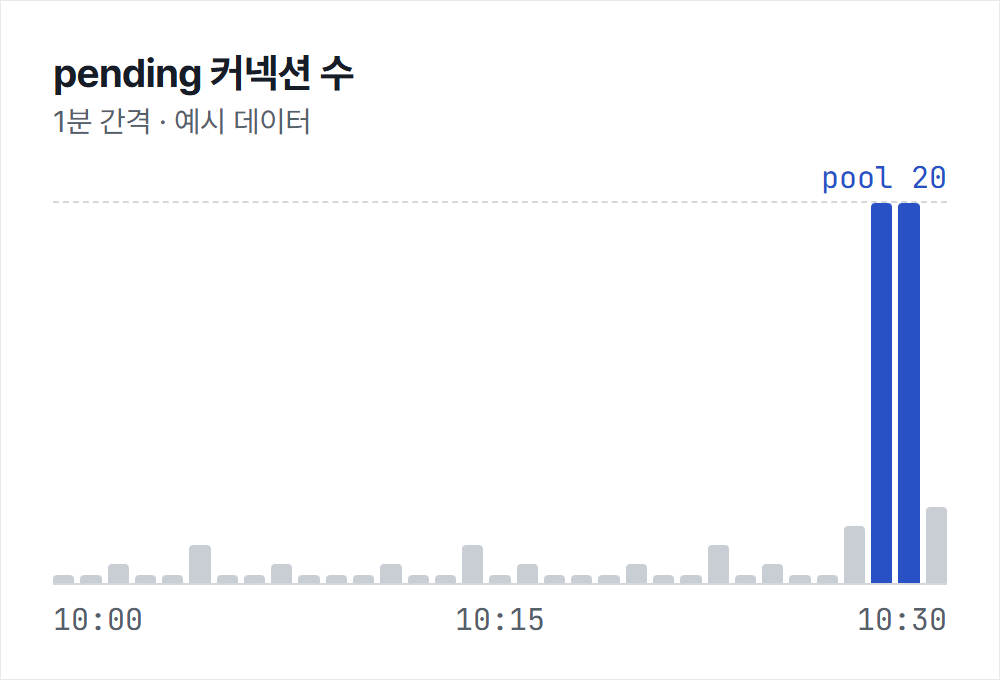

> 이 글은 레이아웃 검증용 **예시 글**입니다. `draft: true`라서 실제 사이트에는 배포되지 않습니다.

배포 직후 30분마다 API 응답이 5초씩 멈췄다. 로그에는 `Connection is not available, request timed out after 30000ms` 한 줄만 남아 있었다. 이 글은 풀 고갈의 원인을 스레드 덤프로 좁혀 간 과정과, 재발을 막기 위해 바꾼 설정을 정리한다.

## 증상: 30분 주기의 5초 정지

처음 의심한 것은 DB였지만 슬로 쿼리 로그는 비어 있었다. 대신 풀 메트릭의 `pending`이 0에서 20으로 튀는 순간이 정지와 정확히 겹쳤다.[^metrics]

| 시각 | active | idle | pending | p99 응답 |
| ---- | -----: | ---: | ------: | -------: |
| 10:00 | 4 | 16 | 0 | 120ms |
| 10:30 | 20 | 0 | 20 | 5,040ms |
| 10:31 | 6 | 14 | 0 | 140ms |


*30분 주기 작업이 도는 순간에만 pending이 풀 한도까지 찬다. (예시 데이터)*

## 스레드 덤프로 원인 좁히기

정지가 시작되는 순간 <kbd>Ctrl</kbd> + <kbd>\\</kbd> 대신 `jstack`으로 덤프를 세 번 떴다.

```bash title="dump.sh"
for i in 1 2 3; do
  jstack -l "$(pgrep -f app.jar)" > "dump-$i.txt"
  sleep 2
done
grep -c "HikariPool.getConnection" dump-*.txt
```

### 대기 스레드 패턴

스무 개의 요청 스레드가 모두 같은 지점에서 커넥션을 기다리고 있었고, 커넥션을 쥔 쪽은 외부 HTTP 호출을 기다리는 스케줄러 스레드였다.

```java title="ReportScheduler.java" {4-5}
@Scheduled(cron = "0 */30 * * * *")
@Transactional
public void syncReports() {
    List<Report> reports = reportRepository.findPending();
    reports.forEach(r -> externalClient.push(r)); // 트랜잭션 안에서 외부 호출
}
```

## 트랜잭션 경계 바로잡기

외부 호출을 트랜잭션 밖으로 빼고, 조회와 상태 갱신만 짧은 트랜잭션으로 묶었다.

```java title="ReportScheduler.java"
@Scheduled(cron = "0 */30 * * * *")
public void syncReports() {
    List<Report> reports = reportService.loadPending(); // [!code --]
    List<Report> reports = reportService.loadPendingReadOnly(); // [!code ++]
    reports.forEach(r -> {
        externalClient.push(r);
        reportService.markSent(r.getId()); // [!code highlight]
    });
}
```

## 풀 크기와 타임아웃 재설정

풀 크기는 그대로 두고, 기다리는 쪽이 빨리 실패하도록 타임아웃을 줄였다.

```yaml title="application.yml"
spring:
  datasource:
    hikari:
      maximum-pool-size: 20
      connection-timeout: 3000      # 30s → 3s, 빨리 실패
      leak-detection-threshold: 2000
```

로그 한 줄이 아주 길 때도 페이지가 아니라 코드 블록 안에서만 가로로 스크롤되어야 한다.

```text
2026-11-03T10:30:00.123+09:00 WARN 4821 --- [scheduling-1] com.zaxxer.hikari.pool.ProxyLeakTask : Connection leak detection triggered for org.postgresql.jdbc.PgConnection@5f2a9c1 on thread scheduling-1, stack trace follows
```

## 재발 방지 체크리스트

1. 트랜잭션 안에서 외부 I/O를 하지 않는다.
2. `leak-detection-threshold`를 운영에서도 켠다.
3. 풀 메트릭을 대시보드에 올리고 `pending` 경보를 건다.

- [x] 스케줄러 트랜잭션 분리
- [x] 타임아웃 조정
- [ ] 부하 테스트에 30분 주기 작업 포함

참고한 문서는 [HikariCP 설정 문서](https://github.com/brettwooldridge/HikariCP#gear-configuration-knobs-baby)와 아주 긴 주소의 예시 https://example.com/a/very/long/path/that/should/wrap/instead/of/breaking/the/layout/on/small/screens/2026/11/03 이다.

[^metrics]: Micrometer의 `hikaricp.connections.pending` 지표를 1초 간격으로 수집했다.
